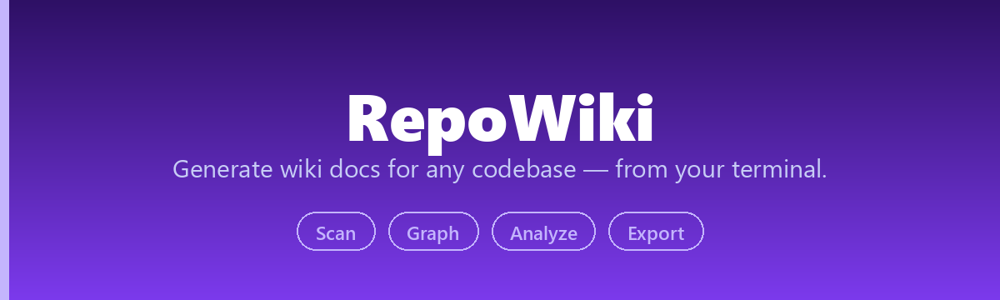
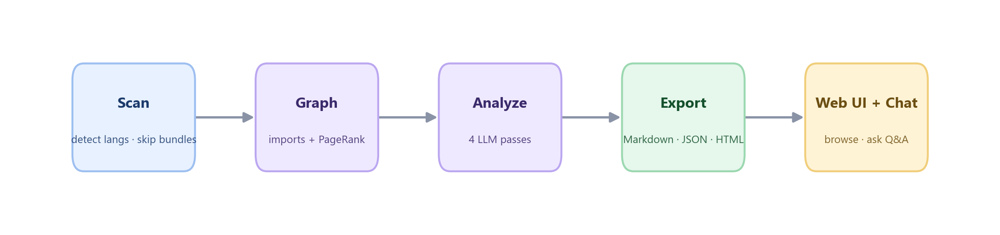

<div align="center">



[](https://pypi.org/project/repowiki/)
[](https://pypi.org/project/repowiki/)
[](LICENSE)
[](https://github.com/he-yufeng/RepoWiki/actions/workflows/ci.yml)

[**Live Demo**](https://he-yufeng.github.io/RepoWiki/) · [**Quick Start**](#quick-start) · [**How It Works**](#how-it-works) · [**Why RepoWiki?**](#why-repowiki) · [中文](README_CN.md)

</div>

**Open-source DeepWiki alternative** — generate comprehensive wiki documentation for any codebase from your terminal or browser.

The live demo is RepoWiki eating its own dog food: the wiki for this very repo, generated by `repowiki scan . --site` and served from GitHub Pages.

## Why RepoWiki?

| | DeepWiki | deepwiki-open | **RepoWiki** |
|---|---------|--------------|-------------|
| Deploy | SaaS only | Docker Compose | **`pip install repowiki`** |
| Local repos | No | No | **Yes** |
| CLI | No | No | **Yes** |
| Web UI | Yes | Yes | **Yes** |
| Export | Web only | Web only | **Markdown / JSON / HTML** |
| Reading guide | No | No | **PageRank + guided path** |
| Terminal Q&A | No | No | **`repowiki chat`** |
| Dependencies | N/A | Docker + PostgreSQL | **Python + SQLite** |

## Quick Start

```bash
pip install repowiki

# set your API key (DeepSeek, OpenAI, Anthropic, etc.)
export DEEPSEEK_API_KEY=<your-api-key>
# or
repowiki config set api_key <your-api-key>

# scan a local project
repowiki scan ./my-project

# scan a GitHub repo
repowiki scan https://github.com/pallets/flask

# scan a private GitHub repo (token never touches logs or errors)
GITHUB_TOKEN=ghp_xxx repowiki scan https://github.com/acme/private-repo

# generate self-contained HTML
repowiki scan ./my-project --format html --open

# start the web interface (wheels from PyPI ship the built UI)
pip install repowiki[web]
repowiki serve ./my-project   # optionally preload a project
```

RepoWiki respects `.gitignore` and `.repowikiignore` during scans. It also skips common local secret files such as `.env`, `.env.local`, `.npmrc`, `.pypirc`, and SSH private keys by default.

## Features

- **Structured wiki** — project overview, per-module docs, auto-detected architecture with Mermaid diagrams, and a PageRank "start here" reading path.
- **Cross-linked pages**: a backticked symbol or file path that matches another wiki page becomes a link to it, as a relative `.md` link in Markdown and as in-page navigation in the HTML export. Fenced code blocks stay untouched, and a name defined on several pages links to the first one.
- **Symbol index**: a global index page collects every key symbol the analysis documents, grouped by kind and then by module, with each entry linking back to the module page that owns it. A project with no documented symbols skips the page.
- **Test map**: a page that lists, for each source file, the test files that import it and the names they pull from it, plus the source files no test imports and the test files that reach no product code at all. Deterministic, like the call and data-flow views: "untested" here means "nothing imports it from a test", which is where to look, not a coverage claim.
- **Knowledge cards**: a cards page distills every module to one card: purpose, file count, the symbols and concepts it exposes, its internal links, the entry file to open first, and, when the repo has usable git history, the files with the most commits. It is the fastest way to pick a starting point before reading anything longer.
- **Incremental re-runs**: the output directory keeps a `.repowiki-state.json` mapping each page to the inputs that generated it, so re-scanning only regenerates pages whose source changed and deletes pages of removed modules. JSON and HTML exports skip the write entirely when nothing changed. Pass `--full` to force a full rebuild. Unchanged pages also skip the LLM call itself: analysis results sit in a content-keyed SQLite cache (`~/.repowiki/cache.db`), so a re-scan after a small edit costs no API calls for untouched modules. To auto-refresh on commit, trigger a scan from `.git/hooks/post-commit` (`repowiki scan . --site -o docs/wiki &`) or from CI on push — the caches make that cheap, so no watcher daemon is needed.
- **Review order for a diff** — `repowiki diff . main...HEAD` ranks a change's files by real importance (repo-wide PageRank plus each file's blast radius: how many files import it), so a reviewer starts where the change actually matters. Deleted files sort last but stay listed; `--format json` hands the same review order to an agent.
- **Import-aware ranking** — resolves Python and JS/TS imports before ranking files, and skips minified/generated bundles so they don't burn LLM context.
- **Symbol skeletons for oversized files** — a Python module too big for the per-file context budget used to contribute only its first 4,096 characters. Now the analyzer sees an ast-derived skeleton instead: every top-level class and function with its signature and docstring, so a 2,000-line module is read by structure, not by head.
- **Honest coverage reporting** — when the scan can't take the whole repo, it says so: the overview page and the CLI both flag partial coverage (files kept vs. candidates, oversized and excluded paths), so a wiki never quietly claims to be complete.
- **Failure-honest LLM calls** — rate limits and connection drops get retried with backoff; if a module still can't be analyzed, the run ends with a warning naming every placeholder module instead of quietly shipping a half-empty wiki.
- **Three output formats** — a Markdown directory to commit, structured JSON, or a self-contained HTML file to share (diagrams included).
- **Static site publishing**: `repowiki scan . --site` drops a docsify loader (`index.html` + `.nojekyll`) into the Markdown export, so the output directory can go straight onto GitHub Pages.
- **Web viewer + terminal chat**: a three-column browser UI, or `repowiki chat .` for grounded Q&A in the terminal. Chat is multi-turn: the conversation so far goes into each prompt, so follow-up questions work in both the web UI and the CLI. Every answer carries its sources at line precision: the CLI prints a `file:start-end` footer under each reply, and the web UI links each reference into a file viewer that opens the exact line range (`/project/<id>/file/<path>#L120-L140`-style links survive refresh and sharing). The zero-LLM analyses are in the web UI too: the sidebar's Repo Map and Diff Review buttons serve the same ranked map and review order the CLI prints, each row linking into the file viewer. A repo scanned from a URL is cached as a shallow clone, so diff refspecs there only reach the shallow history; scan a local full clone to diff arbitrary ranges. The built-in TF-IDF index (no embeddings service) persists across runs and reuses per-file chunks, so a second session on an unchanged repo starts warm and an edit to a few files rebuilds only their chunks instead of the whole index.
- **CLI-first** — no Docker, no database server, no browser required.

```bash
repowiki scan .                    # generate wiki
repowiki scan . --full             # rebuild every page, ignoring incremental state
repowiki scan . -f html --open     # open in browser
repowiki scan . -l zh              # Chinese output
repowiki chat .                    # multi-turn Q&A about the code, remembers the session
repowiki map .                     # ranked repo map, zero LLM calls
repowiki map . --format json       # prompt-ready ranked list for agents
repowiki diff . main...HEAD        # review order for a diff: importance + blast radius
repowiki diff . main...HEAD --importers 5  # show up to five direct importers per changed file
repowiki scan . --site             # markdown export plus a GitHub Pages-ready loader
```

### Trace an import chain

Run this from a local RepoWiki checkout, or substitute paths from your own repository:

```bash
repowiki trace . src/repowiki/core/graph.py src/repowiki/core/models.py --format json
```

`trace` follows imports from the source file to the target file and returns one shortest chain. Use paths relative to the repository root. It makes no LLM calls and sees only the imports the static scan resolves. With `--format json`, `path` and `hops` are `null` when both files are indexed but no chain is found. An unindexed endpoint is a usage error. If the scan is partial, the warning goes to stderr so stdout remains JSON.

### See what a file affects

```bash
repowiki impact . src/repowiki/core/models.py --depth 2 --format json
```

`impact` follows imports in reverse to find which files depend on the target. It lists each importer once, sorted by the number of import hops and then by path. Use `--depth 1` for direct importers or omit it for every reachable importer. JSON includes `dependents` with each `path` and `distance`, plus `direct` and `total` counts within the requested depth. An indexed file with no importers returns an empty list; an unindexed file is a usage error. Like `trace`, this is a local static scan, not a list of runtime callers.

## Languages & Models

Detects Python, JavaScript, TypeScript, Go, Rust, Java, Kotlin, C/C++, C#, Ruby, PHP, Swift, and 30+ more. Any of litellm's 100+ providers works — pick one with an alias or pass it directly:

```bash
repowiki config set model deepseek   # deepseek / claude / gpt / gemini / qwen / kimi / glm / mimo ...
repowiki scan . -m gpt               # or pass a model directly
```

The `mimo` and `mimo-pro` aliases ship Xiaomi's endpoint, so a MiMo API key is all you need. Any other OpenAI-compatible endpoint can be pointed at with `repowiki config set api_base https://your-gateway/v1`.

## Configuration

RepoWiki looks for config in this order:
1. CLI flags (`-m`, `-l`, `-o`)
2. Environment variables (`REPOWIKI_MODEL`, `REPOWIKI_API_KEY`, `REPOWIKI_API_BASE`)
3. Config file (`~/.repowiki/config.json`)
4. Provider-specific env vars (`DEEPSEEK_API_KEY`, `OPENAI_API_KEY`, `ANTHROPIC_API_KEY`)

For private GitHub repositories, set `GITHUB_TOKEN` (or `GH_TOKEN`): the clone goes out authenticated and the token is used only inside the git invocation, never written to logs or error output.

## Project Structure

```
RepoWiki/
├── src/repowiki/
│   ├── cli.py              # Click CLI with scan/serve/chat/config commands
│   ├── config.py           # Configuration management
│   ├── core/
│   │   ├── scanner.py      # File scanning with language detection
│   │   ├── analyzer.py     # Multi-step LLM analysis pipeline
│   │   ├── graph.py        # Dependency graph + PageRank
│   │   ├── wiki_builder.py # Wiki page assembly
│   │   ├── rag.py          # TF-IDF retrieval for Q&A
│   │   ├── cache.py        # SQLite caching
│   │   ├── skeleton.py     # Symbol-level skeletons for oversized files
│   │   ├── diff.py         # Review-order ranking for git diffs
│   │   ├── models.py       # pydantic data models
│   │   └── state.py        # Incremental regeneration state
│   ├── llm/
│   │   ├── client.py       # litellm async wrapper
│   │   └── prompts.py      # Structured prompt templates
│   ├── ingest/
│   │   ├── local.py        # Local directory ingestion
│   │   └── github.py       # Git clone with caching
│   ├── export/
│   │   ├── markdown.py     # Markdown directory export
│   │   ├── json_export.py  # JSON export
│   │   ├── html.py         # Self-contained HTML export
│   │   └── site.py         # GitHub Pages site loader
│   └── server/             # FastAPI web backend
├── frontend/               # React + Vite + TailwindCSS
├── pyproject.toml
└── LICENSE
```

## How It Works



1. **Scan** — Walk the directory tree, filter out binaries, generated bundles, and oversized files, detect languages and entry points
2. **Graph** — Resolve imports across 6 languages, including Python package-relative and
   JavaScript/TypeScript relative modules, then run PageRank to rank file importance
3. **Analyze** — Send file tree + key files to LLM in 4 structured passes (overview, modules, architecture, reading guide)
4. **Cache** — Store results in SQLite keyed by content hash, skip unchanged files on re-scan
5. **Export** — Assemble wiki pages with Mermaid diagrams and source links, output in chosen format

## Development

```bash
git clone https://github.com/he-yufeng/RepoWiki.git
cd RepoWiki

# backend
python -m venv .venv && source .venv/bin/activate
pip install -e ".[dev,web]"

# frontend
cd frontend && npm install && npm run dev

# run backend
repowiki serve --port 8000

# tests + retrieval eval
pytest tests/
python evals/run_eval.py
```

The retrieval eval (`evals/`) runs fixture repos through the real ingest and
index path and checks that questions with known source files still retrieve
them, through the plain channel and through the module-card channel (whose
fixture suite includes paraphrase and Chinese questions). It runs blocking
inside pytest and as a soft (non-blocking) gate in CI; run
`python evals/run_eval.py --update-baseline` after an intentional
retrieval change.

## Roadmap

Generation, the web interface, and the diagrams work, pages link to each other, re-runs only regenerate the pages whose source changed, `scan --site` exports a GitHub Pages-ready site, and the repo map plus diff review order run in both the CLI and the web UI. Two deterministic AST-derived views ship in the architecture page alongside the model-written diagrams: a Python call graph (who calls whom) and a data-flow graph (for each project class, which functions create it and which receive it), and a Test Map page indexes which test files import which source files, so the structural picture stays correct even when the LLM-written parts come from cache.

## Related Projects

If RepoWiki helped you find your way around a codebase, a few other things I've built:

- [**CoreCoder**](https://github.com/he-yufeng/CoreCoder) — want to understand how a coding agent really works? Read the whole ~1k-line engine end to end, not a black box.
- [**FindJobs-Agent**](https://github.com/he-yufeng/FindJobs-Agent) — stop sifting job boards by hand: it ranks postings against your resume and runs mock interviews.
- [**ContractGuard**](https://github.com/he-yufeng/ContractGuard) — catch the risky clauses before you sign: it reads contracts and flags the dangerous bits.
- [**GitSense**](https://github.com/he-yufeng/GitSense) — want to contribute to open source? It finds issues worth your time and gauges whether your PR will get merged.
- [**CodeABC**](https://github.com/he-yufeng/CodeABC) — understand any codebase even if you don't code, built for non-programmers.

## License

MIT
